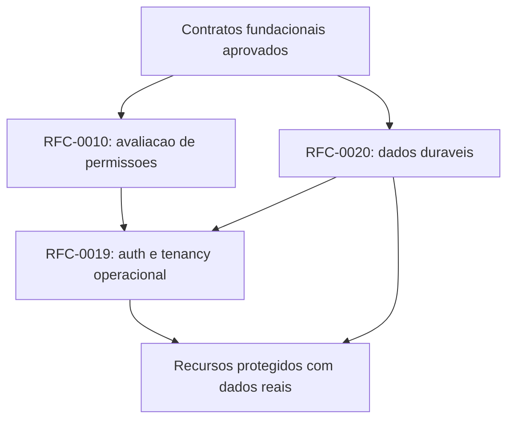

# Dependency Graph do Veltryx OS

Revisao: 2026-10-24. Este mapa distingue dependencia normativa, relacao futura e dependencia de integracao. Numeracao de RFC nao estabelece uma cadeia obrigatoria.

## Regra de dependencia

Detalhes externos dependem de contratos internos. Infrastructure implementa portas; nao governa dominio. Core nao conhece modulos de negocio; Runtime nao depende de Builder. Module/Plugin nao acessa internals de outro owner. Registries catalogam declaracoes; adapters implementam transporte e apresentacao.

| Consumidor              | Dependencias permitidas                                                             | Dependencias proibidas                                                  |
| ----------------------- | ----------------------------------------------------------------------------------- | ----------------------------------------------------------------------- |
| Core / Contracts        | Contratos internos estaveis e declaracoes aprovadas                                 | Business Modules, Next/React, driver/ORM e secrets de infraestrutura    |
| Runtime                 | Contratos de Core, metadata resolvida, components, services, contexto e autorizacao | Builder, renderer concreto, storage interno de modulo                   |
| Metadata Engine         | Core contracts e registros publicos de modulos/services                             | Implementacao visual, Runtime implementation, SQL                       |
| UI Composition          | Metadata resolvida, Runtime Context e Component Registry por contrato               | DOM/React/CSS, regra de negocio ou implementacao concreta de componente |
| Builder                 | Contratos de metadata/components e Runtime preview aprovado quando existir          | Instanciar componente concreto ou controlar Module Loader               |
| Modules / Plugins       | Core contracts, eventos e contratos publicos declarados em manifesto                | Internals ou storage de outro owner                                     |
| Admin adapters          | APIs publicas de Kernel, Composition Tree e implementacao visual local              | Regras de dominio e imports de Core internals                           |
| Infrastructure adapters | Portas publicas e tecnologia concreta na borda                                      | Politica de dominio e dependencia inversa do Kernel no driver           |

O Admin Composition Adapter e uma excecao de apresentacao delimitada por IMP-0029/0030 e ADR-0004: React fica em `apps/admin`. Nao e Runtime Adapter de publicacao.

## Dependencias normativas existentes

| RFC      | Depends On declarado                                               | Status                                     |
| -------- | ------------------------------------------------------------------ | ------------------------------------------ |
| RFC-0001 | Nenhuma                                                            | Frozen                                     |
| RFC-0002 | RFC-0001                                                           | Frozen                                     |
| RFC-0003 | RFC-0001, RFC-0002                                                 | Frozen                                     |
| RFC-0004 | RFC-0001, RFC-0002, RFC-0003                                       | Frozen                                     |
| RFC-0005 | RFC-0001..0004                                                     | Frozen                                     |
| RFC-0006 | RFC-0001..0005                                                     | Frozen                                     |
| RFC-0007 | RFC-0001..0006                                                     | Frozen                                     |
| RFC-0011 | Cabecalho resumido; IMP-0033 declara 0002, 0004, 0006, 0013 e 0099 | Approved, somente foundation               |
| RFC-0013 | Cabecalho resumido; IMP-0032 declara 0002, 0006 e 0099             | Approved, somente API estrutural read-only |
| RFC-0015 | RFC-0001, 0002, 0004, 0005, 0006 e 0099                            | Approved, somente contratos/in-memory      |

RFC-0099 governa todos os documentos; essa relacao nao e dependencia de runtime. A governanca possui referencias a RFCs fundacionais, mas nao cria ciclo operacional.

## Dependencias propostas (nao aprovadas)

Todas incluem RFC-0099 como governanca. Relacoes abaixo nao alteram as RFCs Approved/Frozen.

| RFC Draft                    | Dependencias normativas propostas      | Relacoes condicionais / de integracao                                                      |
| ---------------------------- | -------------------------------------- | ------------------------------------------------------------------------------------------ |
| RFC-0008 Runtime Adapters    | RFC-0001, 0005, 0006, 0007 e ADR-0004  | Consome Application Model da 0009 quando disponivel; deploy operacional deve observar 0018 |
| RFC-0009 Builder/Application | RFC-0001, 0003, 0005, 0006, 0007       | Publicacao externa exige 0008; ativacao protegida e duravel exige 0010/0019/0020           |
| RFC-0010 Permission Engine   | RFC-0001, 0002, 0004, 0006, 0011       | Provider em memoria pode ser testado isoladamente; identidade operacional exige 0019       |
| RFC-0012 Workflow            | RFC-0004, 0006, 0010, 0016, 0020       | Scheduler/worker por IMP proprio                                                           |
| RFC-0014 Query               | RFC-0004, 0005, 0006, 0010, 0015       | Dados reais exigem 0019/0020; HTTP de dados exige extensao da API                          |
| RFC-0016 Event System        | RFC-0002, 0003, 0004                   | Outbox/relay duraveis exigem 0020; despacho local existente nao exige banco                |
| RFC-0017 Observability       | RFC-0001, 0002, 0004                   | Exporter concreto por adapter; nao substitui auditoria                                     |
| RFC-0018 Deployment          | RFC-0001, 0004, 0017                   | Dados exigem 0020; publicacao de sites exige 0008                                          |
| RFC-0019 Auth operacional    | RFC-0001, 0002, 0004, 0010, 0011, 0020 | HTTP transporta credenciais; Kernel recebe contexto validado                               |
| RFC-0020 Dados duraveis      | RFC-0001, 0004, 0015                   | Scoped repository recebe contexto confiavel; nao depende da implementacao do login         |

RFC-0008 e RFC-0009 compartilham conceitos, mas nao exigem implementacao mutua: schema universal/composicao e a fronteira; publicacao externa e consumidor separado. RFC-0010 recebe principal confiavel sem depender do mecanismo de login da RFC-0019. RFC-0020 recebe scope confiavel sem importar Auth implementation.

## Grafo da proxima integracao operacional

Setas mostram pre-condicoes da integracao proposta, nao imports concretos. O Permission Engine puro pode ser provado em memoria; isso nao autoriza dados reais.

## Validacao e limites

A leitura das dependencias declaradas nao identifica ciclo entre as propostas normativas acima. Relacoes condicionais nao devem ser convertidas em imports ou gates universais sem revisao. Nao foi realizada prova completa do grafo de imports de todo o codigo nesta tarefa documental.

Checar em cada IMP: dependencies declaradas, contratos publicos, ausencia de acesso a internals, cache/scope e lifecycle. Dependencias circulares obrigatorias entre modulos/services continuam proibidas e devem ser rejeitadas pelos resolvers.

## Referencias

[Architecture Index](architecture-index.md), [Roadmap](IMPLEMENTATION-ROADMAP.md), [Implementation Guide](IMPLEMENTATION-GUIDE.md), [Governance](../rfc/RFC-0099-architecture-governance.md), [ADR-0004](../adr/ADR-0004-builder-runtime-agnosticism.md).
