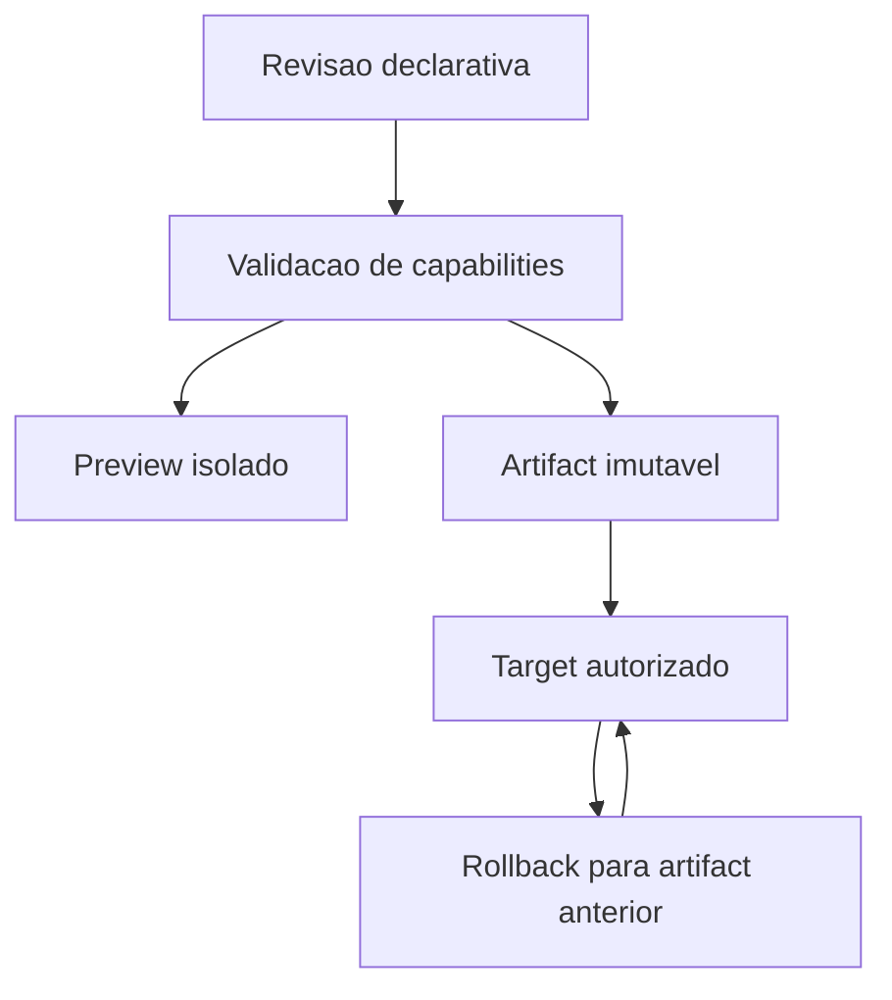

# RFC-0008 Runtime Abstraction & Platform Adapters

## Status

Draft

Version: 0.2

Type: RFC arquitetural

Owner: Architecture Owner (designacao nominal pendente)

Reviewers: Maintainers de Runtime/Contracts (designacao pendente)

Created: data original nao registrada

Last Updated: 2026-10-24

Depends On: RFC-0001, RFC-0005, RFC-0006, RFC-0007, RFC-0099

Related To: ADR-0004, RFC-0009, RFC-0018

Supersedes: None

## Indice

- [Summary](#summary)
- [Core Principles](#core-principles)
- [Site Schema](#site-schema)
- [Runtime Adapter Contract](#runtime-adapter-contract)
- [WordPress Strategy](#wordpress-strategy)
- [Revisao complementar de 2026-10-24](#revisao-complementar-de-2026-10-24)

## Summary

Define a abstracao de runtimes e platform adapters do Veltryx OS para garantir que Builder, Site Schema, Component Registry e UI Composition Runtime permanecam agnosticos de framework, runtime e plataforma.

Veltryx OS e o Control Plane. Sites publicados pertencem ao Delivery Plane.

## Core Principles

- Builder is not Renderer.
- Builder is not Next.js.
- Site Schema is the universal contract.
- Component Registry defines contracts, not implementations.
- UI Composition Runtime produces universal composition models.
- Runtime Adapters translate schema/composition to target platforms.
- Published sites must not depend on continuous Admin availability.
- Managed sites use Veltryx OS as source of truth.

## Runtime Targets

- Veltryx Next Runtime.
- WordPress Runtime.
- Static Runtime.
- Future runtimes.

## Site Schema

Site Schema is the universal, versioned and serializable contract for pages, sections, components, slots, content references, layout hints, semantic intent, visibility rules and action bindings.

Site Schema must not contain concrete component implementations, executable callbacks, framework imports, platform-specific templates, DOM nodes, framework routes or implementation file paths.

## Component Registry

The central Component Registry stores component contracts only:

- key.
- version.
- name and label.
- description.
- propsSchema.
- slots.
- capabilities.
- constraints.
- metadata.
- tags.
- source.

Concrete implementation mapping belongs to Runtime Adapters.

## UI Composition Runtime

The UI Composition Runtime transforms public metadata or Site Schema into a Composition Tree. The output is an intermediate model and must remain independent of visual implementations and target platforms.

## Runtime Adapter Contract

A future implementation must define:

- validateCompatibility.
- preview.
- publish.
- deploy.
- rollback.
- supportedCapabilities.
- component implementation mapping.
- version compatibility.
- target platform.

## Runtime Capabilities

Future runtime capabilities may include preview, publish, rollback, static export, server rendering, client rendering, incremental build, media sync, forms, dynamic routes, SEO, theme tokens and custom code.

The Site Schema and Component Registry must not assume every runtime supports the same capabilities. Compatibility validation belongs to Runtime Adapters.

## WordPress Strategy

### Managed Mode

```text
Veltryx OS
    |
    v
Site Schema
    |
    v
WordPress Runtime Adapter
    |
    v
Plugin Veltryx
    |
    v
WordPress
```

In Managed Mode, Veltryx OS is the source of truth. Publish sends schema, build output or configuration to WordPress.

### Native Mode

Veltryx components may exist as Gutenberg Blocks in the future. This RFC does not define that implementation.

## Non Goals

- Implementar WordPress agora.
- Implementar plugin WordPress agora.
- Implementar Gutenberg agora.
- Implementar Next Runtime agora.
- Implementar sincronizacao bidirecional.
- Implementar Renderer visual nesta RFC.
- Implementar Publishing Pipeline completo.
- Implementar Builder visual.

## Acceptance Guardrail For TASK-0312

TASK-0312 can only be approved when Component Registry and UI Composition Runtime remain fully declarative, runtime-agnostic, platform-agnostic and free from concrete implementation mappings.

## Revisao complementar de 2026-10-24

Esta revisao completa a proposta para analise. Status permanece Draft; nao autoriza Runtime Adapters de publicacao. O Admin Composition Adapter existente continua limitado por IMP-0029/0030 e ADR-0004.

### Lifecycle e resultados propostos

Uma solicitacao identifica revisao de schema/composicao, adapter/version, target e contexto autorizado. Validacao compara capabilities requeridas e suportadas antes de construir qualquer artifact. Capability desconhecida ou incompatibilidade gera erro explicito; nao descartar a funcionalidade silenciosamente.

Preview e isolado do target ativo e usa revisao identificada. Publish prepara artifact imutavel vinculado a checksum, schema/component versions e adapter version. Deploy promove artifact para target somente apos validacao e autorizacao. Rollback seleciona artifact anterior compativel; nao desfaz dados ou migrations externas implicitamente.

Uma falha mantem o target ativo anterior ou indica estado parcial recuperavel. Repeticao usa identificador idempotente por target/revisao/operacao. O protocolo de adapter devera diferenciar sucesso, incompatibilidade, nao autorizado, indisponivel e conflito; nao prometer transacao distribuida.



### Seguranca, tenancy e observabilidade

Build e deploy recebem somente dados autorizados do tenant e target. Credenciais do destino sao resolvidas no adapter por infraestrutura; nunca entram em Site Schema, Composition Tree, manifest publico ou bundle de cliente. Dominio/target exige ownership verificado; URLs fornecidas nao autorizam acesso a rede interna. Custom code e callbacks executaveis continuam fora do schema universal.

Registrar operationId, revisao, adapter, target seguro, requestId/correlationId e resultado, sem secret ou payload sensivel. Logs de build sao restritos e sanitizados. Delivery nao depende da disponibilidade continua do Admin; revogacao e dados dinamicos exigem desenho proprio antes de serem anunciados como suportados.

### Compatibilidade e alternativas

Nenhum contrato exportado atual e alterado por esta revisao. Novas capabilities sao opt-in; incompatibilidade de schema/adapter impede publicacao. Core e contratos nao importam Next, WordPress, DOM ou template executavel. Extensoes incompativeis exigem nova versao e migracao explicita de artifacts.

Acoplar Builder ao primeiro framework reduz trabalho inicial, mas viola ADR-0004 e limita targets. Sincronizacao bidirecional WordPress exigiria resolucao de conflitos e ownership; permanece fora desta proposta. Managed Mode conserva Veltryx como fonte de verdade.

### Criterios de aceite futuros

- Mesmo schema e validavel sem importar framework do target no Core.
- Capability nao suportada bloqueia antes de qualquer alteracao no destino.
- Preview nao modifica publicacao ativa.
- Artifact identifica versoes e checksum; deploy repetido nao duplica efeitos.
- Rollback tem alvo conhecido e falha explicitamente em incompatibilidade.
- Target de outro tenant e rejeitado; credenciais nunca aparecem no artifact publico.
- Site estatico publicado continua disponivel com Admin indisponivel.

### Riscos e decisoes pendentes

Formato final de Artifact Manifest, assinatura/integridade, primeiro target, politica de custom code, validade de preview e operacoes compensatorias exigem revisao antes de aprovar IMP de adapter. A relacao com Application Model e de consumo por schema; nao criar dependencia circular entre RFC-0008 e RFC-0009.

### Glossario e aprovacao

Artifact: resultado imutavel preparado para delivery. Target: destino autorizado. Capability: funcao explicitamente suportada pelo adapter. Managed Mode: Veltryx como fonte declarativa de verdade.

- [ ] Owner/reviewers nominais definidos.
- [ ] Contrato de artifact e capabilities fechado.
- [ ] Cross Review com RFC-0005/0006/0007/0009 e ADR-0004 concluido.
- [ ] Estrategia de secrets, target ownership, falha parcial e rollback validada.
- [ ] Aprovacao registrada pelo Architecture Owner.

Historico: 2026-10-24 — Codex, revisao documental 0.2; preservados principios e status Draft; sem implementacao ou aprovacao.
