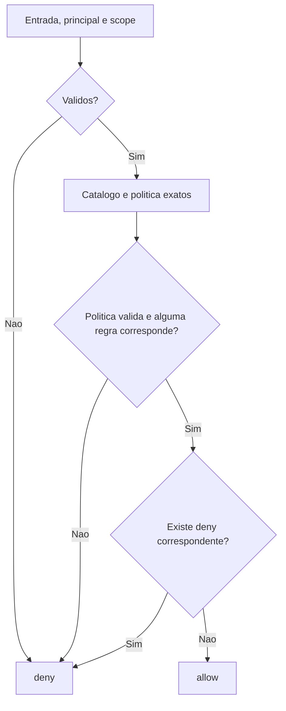

# RFC-0010: Permission Engine

Status: Review

Version: 0.2

Type: RFC arquitetural

Owner: Architecture Owner do repositorio (aprovacao nominal pendente)

Reviewer tecnico desta revisao: Codex

Created: 2026-10-24

Last Updated: 2026-10-24

Depends On: RFC-0001, RFC-0002, RFC-0004, RFC-0006, RFC-0011, RFC-0099

Impacts: Contracts, Core Service Registry/DI; consumo futuro por Runtime, Modules, APIs e Builder

Supersedes: None

Pronta para decisao do owner apos revisao tecnica. Status Review nao autoriza implementacao de producao. O registro da revisao esta em [RFC-0010 Cross Review](../docs/RFC-0010-CROSS-REVIEW.md).

## Indice

1. [Objetivo e fronteiras](#1-objetivo-e-fronteiras)
2. [Origem de confianca](#2-origem-de-confianca)
3. [Recursos, scopes e politica](#3-recursos-scopes-e-politica)
4. [Contratos publicos](#4-contratos-publicos)
5. [Algoritmo e precedencia](#5-algoritmo-e-precedencia)
6. [Resultados e falhas](#6-resultados-e-falhas)
7. [Lifecycle e integracao](#7-lifecycle-e-integracao)
8. [Seguranca e observabilidade](#8-seguranca-e-observabilidade)
9. [Compatibilidade e alternativas](#9-compatibilidade-e-alternativas)
10. [Criterios de aceite](#10-criterios-de-aceite)
11. [Riscos e limites](#11-riscos-e-limites)
12. [Glossario, referencias e aprovacao](#12-glossario-referencias-e-aprovacao)

## 1. Objetivo e fronteiras

Definir a primeira decisao de permissao deterministica do Kernel. A baseline `936ddd4` possui Principal, AuthContext e Execution Context, mas ainda nao possui avaliador. A nova capacidade recebe identidade de origem confiavel e avalia uma acao de recurso contra politica explicita, sem alterar os contratos existentes.

A entrega e limitada a grants exatos por principal ou role, scopes tenant/workspace e provider em memoria para provas de contrato. O nucleo da decisao e puro para a mesma entrada, catalogo e snapshot de politica; a fachada assincrona apenas consulta uma porta de politica e normaliza falhas.

Ficam fora: login, sessao verificavel, memberships reais, enforcement HTTP, persistencia de grants, RBAC administrativo, ABAC, cache, wildcard, heranca, escopo global, regras por objeto/field e integracao automatica com metadata/menu. Regras de objeto e field exigem extensao revisada antes de uso; o MVP nao recebe `objectId` nem promete autorizar instancias de dados.

## 2. Origem de confianca

O chamador server-side e responsavel por obter identidade validada e contexto autorizado. Objetos TypeScript, marcas como `trusted: true`, headers, claims livres ou roles em texto nao provam autenticacao. O avaliador nao pode distinguir um chamador confiavel de codigo malicioso executando no mesmo processo; esse limite e pre-condicao do contrato.

A identidade vem do contrato existente `Principal`, usando apenas id, kind e status. `Principal.roles`, `Principal.claims`, `ExecutionContext.roles` e `ExecutionContext.permissions` **nao concedem permissoes neste MVP**. O provider confiavel fornece as roles efetivamente vinculadas ao principal no scope consultado, junto com a politica. Nenhuma role global de um tenant e reaproveitada em outro.

User, service ou system precisam estar active. Anonymous sempre recebe deny, mesmo se fornecido artificialmente com status active. System nao possui bypass; sua origem interna deve ser validada pelo chamador antes da avaliacao. AuthBridge atual nao autentica users/services: fixtures de teste nao equivalem a login real.

Tenant e workspace reutilizam `TenantContext` e `WorkspaceContext` da RFC-0011. Status active e igualdade de IDs sao verificacoes estruturais adicionais, nao consultas de membership. A futura RFC-0019 e responsavel por comprovar vinculos antes de chamar esta porta em recursos protegidos.

## 3. Recursos, scopes e politica

### Catalogo

Cada `PermissionResource` tem namespace, name, version, owner, scopeKind (`tenant` ou `workspace`) e actions. A chave e a tupla namespace/name/version, sem concatenacao ambigua. `PermissionAction` e identificador textual exato, sem wildcard.

Namespace, name, owner, action e roleId usam identificadores case-sensitive: comecam por letra ASCII minuscula; demais caracteres sao letras ASCII minusculas, digitos, ponto, hifen ou underscore; tamanho total de 1 a 128. Versao de recurso e token e SemVer numerico de tres partes, sem prefixo, prerelease ou build no MVP (exemplo `1.0.0`). Nao ha resolucao de ranges ou selecao de latest.

IDs de principal/tenant/workspace e policyVersion sao opacos case-sensitive com 1 a 128 caracteres ASCII alfanumericos, ponto, underscore, dois-pontos ou hifen. Nao remover espacos nem alterar caixa silenciosamente: entrada fora do formato falha. Esses limites se aplicam somente aos novos contratos, sem alterar os validadores existentes.

Um recurso exige de 1 a 100 actions distintas. Registro invalido ou chave repetida falha sem alterar catalogo; ate registro identico repetido e duplicidade. Versao nova usa chave nova. Nao ha replace/remove no MVP. Registro bem-sucedido e leitura retornam copias profundamente imutaveis.

### Scope exato

- Scope tenant: kind=tenant e tenantId; contexto possui tenant active e nenhum workspace para essa operacao.
- Scope workspace: kind=workspace, tenantId e workspaceId; contexto possui ambos active e workspace.tenantId igual a tenant.id.
- O scopeKind do recurso deve coincidir com o scope da operacao.
- Grant tenant nao se propaga a workspace; workspace nao se propaga a outro workspace ou ao tenant inteiro. Chamador querendo operacao tenant deve montar explicitamente contexto tenant sem workspace.
- Scope global nao e representavel nesta versao. Strings `default` ou `system` como IDs nao conferem privilegio.

### Snapshot de politica

O lookup pede uma tupla exata de principal.id, principal.kind e scope. O provider retorna snapshot para essa mesma tupla ou null, sem pesquisar parents/fallbacks. Ele e responsavel pela origem confiavel das roles vinculadas naquele scope. A identidade repetida e o scope do snapshot precisam corresponder ao lookup.

O snapshot inclui schemaVersion `1.0.0`, policyVersion opaca, principal, scope, roleIds e rules. RoleIds e rules devem ser finitas, com limites de 100 roles e 1.000 regras por snapshot; roleIds repetidas sao invalidas. Rules possui IDs unicos no snapshot; duplicidade ou qualquer regra malformada invalida o snapshot inteiro, mesmo se a regra nao corresponder ao recurso consultado.

Cada `PermissionRule` tem id, effect (allow/deny), subject (principal com id+kind ou role com roleId), referencia exata do recurso e action. Scope e policyVersion pertencem ao snapshot inteiro: regras nao podem introduzir scope alternativo. Regra para recurso/acao nao registrado ou versao nao suportada invalida o snapshot; nao ignorar silenciosamente uma negativa que nao pode ser interpretada.

Uma regra corresponde quando recurso, versao e action coincidem, e subject e o principal consultado ou uma das roleIds vinculadas pelo provider. Regras validas de outros subjects/recursos nao correspondem. Todas as regras correspondentes sao consideradas; ordem da lista nao importa.

## 4. Contratos publicos

Os nomes abaixo ficam fixados na proposta v0.2. Serao exports futuros de `@veltryx/contracts`, apos aprovacao e implementacao; nao sao APIs disponiveis na baseline.

| Contrato                    | Campos / operacao                                                                                                                               |
| --------------------------- | ----------------------------------------------------------------------------------------------------------------------------------------------- |
| PermissionAction            | Identificador exato de acao                                                                                                                     |
| PermissionResourceReference | namespace, name, version                                                                                                                        |
| PermissionResource          | Referencia, owner, scopeKind, actions                                                                                                           |
| PermissionScope             | Uniao tenant ou workspace definida acima                                                                                                        |
| PermissionSubject           | Uniao principal (id, kind) ou role (roleId); anonymous nao e subject de regra                                                                   |
| PermissionRule              | id, effect, subject, resource, action                                                                                                           |
| PermissionPolicyLookup      | principal (id, kind), scope                                                                                                                     |
| PermissionPolicySnapshot    | schemaVersion, policyVersion, principal (id, kind), scope, roleIds, rules                                                                       |
| PermissionCheckInput        | principal: Principal; tenant: TenantContext; workspace opcional; resource; action; expectedPolicyVersion opcional                               |
| PermissionDecision          | effect, reasonCode, policyVersion: string ou null                                                                                               |
| PermissionReasonCode        | Conjunto fechado da secao 6                                                                                                                     |
| PermissionCatalogResult     | Sucesso com recurso imutavel ou falha com codigo de catalogo                                                                                    |
| IPermissionResourceCatalog  | register(resource) sincrono; get(reference) sincrono devolve recurso imutavel ou null; snapshot() sincrono devolve lista imutavel de definicoes |
| IPermissionPolicyProvider   | resolve(lookup) assincrono devolve snapshot ou null; rejeicao e normalizada pelo avaliador                                                      |
| IPermissionEvaluator        | evaluate(input) assincrono devolve PermissionDecision                                                                                           |

O scope do input e derivado da presenca de workspace: ausente significa tenant, presente significa workspace. Nao se aceita scope paralelo conflitante. Campos adicionais no topo de PermissionCheckInput, incluindo objectId/field, sao rejeitados para nao sugerir suporte a autorizacao por objeto. Os contratos reutilizados Principal/TenantContext/WorkspaceContext preservam seus campos existentes, dos quais apenas as projecoes explicitadas sao consumidas.

Campo opcional ausente e diferente de campo malformado: expectedPolicyVersion presente com valor vazio/null e invalido. Null em workspace nao substitui ausencia. Membros desconhecidos em discriminantes, schemaVersion ou campos de controle de politica sao rejeitados; nao executar getters/callbacks nem aceitar objetos de classe como politica. Validacao deve projetar apenas dados publicos necessarios da identidade/contexto, sem copiar claims ou metadata arbitrarios.

PermissionDecision nao inclui timestamp, grants, regras correspondentes, nomes de roles, payload, stack ou identidade. policyVersion e null antes de obter e validar a identidade/scope de uma politica; apos isso pode indicar a revisao avaliada, inclusive em conflito de expectedPolicyVersion. Os reasonCodes sao diagnostico interno e nao devem ser expostos indiscriminadamente por futura API protegida.

## 5. Algoritmo e precedencia

A primeira falha pela ordem abaixo determina o reasonCode. Toda negativa termina a avaliacao. Nenhum allow e emitido antes de validar o snapshot inteiro.

1. Validar estrutura e formatos da entrada; capturar projecao imutavel antes do primeiro await.
2. Rejeitar anonymous; depois principal cujo status nao seja active.
3. Validar tenant/workspace active, relacao entre IDs e forma do scope.
4. Capturar catalogo imutavel para esta avaliacao; localizar referencia exata do recurso, conferir scopeKind e action registrada, nessa ordem.
5. Consultar provider uma unica vez com lookup sem roles/claims. Excecao/rejeicao vira policyUnavailable; null vira policyNotFound.
6. Validar schema/estrutura/limites do snapshot; conferir principal e scope; validar todas as referencias de regras contra o mesmo catalogo capturado.
7. Se expectedPolicyVersion foi informada, exigir igualdade com policyVersion; nenhuma busca automatica de versao alternativa.
8. Avaliar todas as regras correspondentes: qualquer deny prevalece; senao qualquer allow permite; sem correspondencia resulta em noGrant.
9. Retornar copia profundamente imutavel da decisao. Falha inesperada de processamento deve retornar deny/internalError seguro, nunca sucesso nem excecao com payload.

Nao ha heranca, override de deny por principal mais especifico, ordem por role ou privilegio especial de administrador. A politica deve expressar cada concessao explicitamente.

## 6. Resultados e falhas

| reasonCode                        | effect | Condicao                                                                              |
| --------------------------------- | ------ | ------------------------------------------------------------------------------------- |
| permission.input.invalid          | deny   | Forma, identificador, versao ou campo de controle invalido                            |
| permission.principal.anonymous    | deny   | Principal anonymous, independente de status                                           |
| permission.principal.inactive     | deny   | Principal nao anonymous com status inactive/unknown                                   |
| permission.scope.invalid          | deny   | Tenant/workspace inativo, desconhecido ou relacao inconsistente                       |
| permission.resource.notFound      | deny   | Referencia exata nao registrada                                                       |
| permission.resource.scopeMismatch | deny   | ScopeKind do recurso diferente do contexto                                            |
| permission.action.notFound        | deny   | Acao nao registrada no recurso                                                        |
| permission.policy.unavailable     | deny   | Provider lanca ou rejeita                                                             |
| permission.policy.notFound        | deny   | Provider retorna null                                                                 |
| permission.policy.invalid         | deny   | Snapshot malformado, schema desconhecido, limites/duplicatas ou referencias invalidas |
| permission.policy.subjectMismatch | deny   | Principal.id/kind do snapshot difere do lookup                                        |
| permission.policy.scopeMismatch   | deny   | Scope do snapshot difere do lookup                                                    |
| permission.policy.versionConflict | deny   | expectedPolicyVersion diferente da revisao valida retornada                           |
| permission.denied.explicit        | deny   | Ao menos uma regra deny corresponde                                                   |
| permission.denied.noGrant         | deny   | Politica valida sem regra correspondente                                              |
| permission.allowed.explicit       | allow  | Ao menos um allow corresponde e nenhum deny corresponde                               |
| permission.internal.error         | deny   | Falha inesperada nao classificada, sem detalhe sensivel                               |

Dentro da etapa 6: estrutura/schema/limites e IDs duplicados precedem subjectMismatch; depois scopeMismatch; depois validacao de referencias de regras. Se identidade/scope ainda nao foram validados, policyVersion e null. Uma regra invalida detectada depois desse ponto tambem retorna policyVersion null, porque o snapshot inteiro nao foi validado. versionConflict, explicit deny, noGrant e allow retornam a policyVersion validada.

Falhas do catalogo usam `permission.catalog.invalidDefinition` ou `permission.catalog.duplicateResource`, sem mutar o registro. `get` de referencia malformada ou ausente devolve null; o avaliador valida sua entrada antes desse acesso.

## 7. Lifecycle e integracao

O catalogo permite somente adicoes, copiadas e congeladas no registro. O metodo snapshot() retorna uma lista profundamente imutavel das definicoes declarativas, sem politica, roles, tenants ou dados de usuario. Cada avaliacao captura essa visao de catalogo antes de consultar o provider; uma adicao durante await nao muda a interpretacao daquela decisao. Politicas em memoria sao copiadas/congeladas na construcao do provider. Nao ha metodo publico para alterar grants em runtime nesta entrega.

Tokens propostos: `kernel.permissionCatalog`, `kernel.permissionPolicyProvider` e `kernel.permissionEvaluator`, version `1.0.0`, owner `kernel`, category `kernel`. Lifecycle singleton e permitido para instancias sem contexto atual mutavel: evaluator nunca armazena principal/scope/decisao de request em campos compartilhados. Provider em memoria indexa pela tupla completa, mantendo isolamento entre lookups concorrentes.

A facade proposta `kernel.permissions()` expoe apenas IPermissionEvaluator. Catalogo/provider sao ligados pela composition root confiavel e portas publicas; consumers nao importam classes internas. O bootstrap padrao registra catalogo e provider vazios: toda avaliacao resulta em deny ate configuracao explicita de codigo confiavel. Nenhum modulo ganha grants por estar instalado.

O provider default e a prova de contrato em memoria; substituir provider no mesmo processo em execucao fica fora do MVP. Instancias novas podem receber configuracao explicita. Os contratos de Service Registry/DI existentes sao reutilizados sem nova categoria, novo lifecycle ou dependencia de AuthBridge.

## 8. Seguranca e observabilidade

Metadata visual declara intencao, mas nao concede acesso. Nao consumir permissions textuais de metadata, header ou cookie como politica. Acoes do Runtime, queries, writes e fields terao pontos de enforcement em entregas posteriores, antes de acessar dados protegidos.

Cada resultado inclui reasonCode e revisao segura para correlacao pelo chamador. Nao registrar policy payload, claims, tokens, credenciais ou identificadores pessoais em snapshot publico. A entrega nao cria auditoria duravel nem dependencia de exporter/Event Bus. A futura RFC-0017 pode adicionar sinais por porta aprovada.

A decisao e valida para o snapshot consultado. Nao e capability reutilizavel nem garantia contra revogacao entre check e efeito. Enforcement junto a transacao, revalidacao de membership e revogacao operacional ficam para RFC-0019/0020 e IMPs consumidores. Sem cache nesta entrega.

## 9. Compatibilidade e alternativas

Novos contratos, tokens e facade sao aditivos. Principal, AuthContext, ExecutionContext, IRepository, API read-only, Composition Tree e autorizacoes dos IMPs anteriores mantem sua semantica. Nenhum consumidor atual passa a chamar avaliador automaticamente. Contagem de services em snapshots pode aumentar com os novos registros, sem expor politicas.

O formato de politica com schemaVersion `1.0.0` e estrito. Novas regras/discriminantes exigem versao suportada e revisao de compatibilidade; nao ignorar campos de controle desconhecidos. Catalogo usa match exato de versao; politica de migration e coexistencia de versoes novas sera explicita. Nao ha dado persistido a migrar nesta entrega.

Alternativas rejeitadas: usar Principal.roles sem scope (vazamento entre tenants); herdar grants tenant para qualquer workspace (concessao implicita); last-write-wins entre allow/deny (ordem altera seguranca); provider global que mantem um currentTenant (corrida entre requests); acoplar ao HTTP (viola contratos agnosticos). Negativa explicita e scopes exatos privilegiam previsibilidade, ao custo de mais declaracoes.

## 10. Criterios de aceite

A matriz completa e numerada no [IMP-0034](../docs/IMP-0034-permission-engine-foundation.md). Deve cobrir todos os reasonCodes, validacao do catalogo, schema/versoes, scope exato, roles provenientes somente do provider, precedencia independente da ordem, mutacao antes/durante/depois do await e intercalacao de consultas de tenants distintos.

A mesma entrada, catalogo capturado e snapshot produzem a mesma decisao. Nenhuma falha, ausencia de dado ou valor desconhecido pode produzir allow. O bootstrap atual e a API publica continuam funcionando; isso nao comprova isolamento operacional de dados reais.

## 11. Riscos e limites

O maior risco e chamar o avaliador com identidade ou provider nao confiavel: a tipagem nao resolve essa fronteira. Outro risco e usar um allow de nivel de recurso como autorizacao de qualquer objeto ou field. O MVP explicitamente nao suporta essas granulações. Invalidar o snapshot inteiro por regra invalida reduz disponibilidade em configuracao incorreta, mas evita ignorar negativas.

Nao restam escolhas de nomes, tokens, codigos, scopes, precedencia ou lifecycle para o implementador decidir. Restam a aprovacao nominal do owner e a implementacao/verificacao do IMP. TTL de sessao, storage duravel, enforcement HTTP e regras por objeto nao bloqueiam esta entrega limitada porque pertencem a propostas posteriores.

## 12. Glossario, referencias e aprovacao

Grant: regra allow explicita. Role binding: role que o provider confiavel vincula ao principal no scope consultado. Policy snapshot: pacote imutavel de regras e bindings de uma revisao. Resource permission: decisao para uma capacidade, sem autorizacao automatica de objetos/fields. Scope exato: mesma tupla tenant/workspace, sem heranca.

Referencias: RFC-0001 seguranca/tenancy; RFC-0002 responsabilidades do Core; RFC-0004 tokens/scopes; RFC-0006 Permission Resolution; RFC-0011 identidade estrutural; RFC-0099 governanca. ADR-0004 preserva agnosticismo. RFC-0019/0020/0017 sao consumidores/evolucoes relacionados, nao dependencias para provar este avaliador em memoria.

- [x] Escopo, nao objetivos, contratos, tokens e resultados definidos.
- [x] Compatibilidade, seguranca, tenancy, lifecycle e alternativas revisados tecnicamente.
- [x] Cross Review tecnico registrado por Codex, com limites de autoria explicitos.
- [x] IMP-0034 v0.2 detalha implementacao e testes.
- [ ] Owner/maintainer registra sua revisao e aprovacao nominal.
- [ ] Status Approved registrado conforme RFC-0099 antes de codigo de producao.

Historico: v0.1 em 2026-10-24, Draft inicial. v0.2 em 2026-10-24, Codex: encerradas ambiguidades tecnicas, revisao cruzada documentada e transicao Draft para Review. Nenhuma aprovacao do owner ou implementacao registrada.
